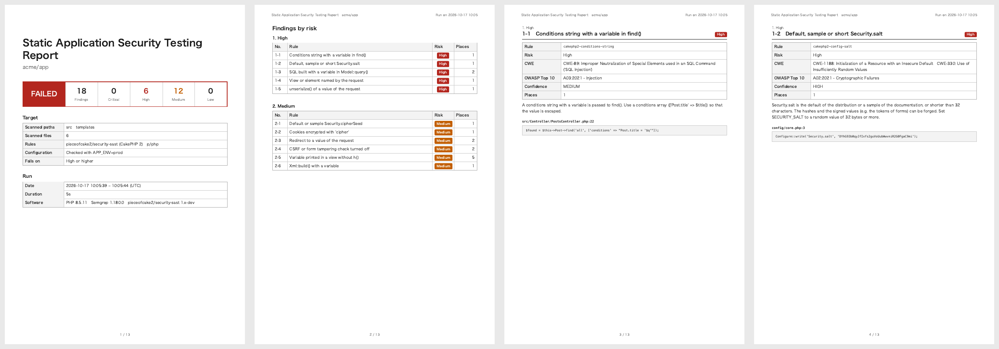

# Security SAST Documentation

Static application security testing (SAST) of a CakePHP 2 application: its code is scanned for patterns that
lead to vulnerabilities, such as SQL built from strings, redirects to values of the request or variables printed
without escaping, and the findings are written as an A4 PDF report by rule and risk, in the design of the
reports of [pieceofcake2/report](https://pieceofcake2.github.io/report/). The exit code fails CI when a finding
reaches a risk.

- [Rules](rules.md): what each rule finds, why it matters, and how to fix it, with the checks of the
  configuration
- [Fixing the Findings](fixing.md): the way through a report, from the first scan to a clean CI
- [CI with GitHub Actions](ci.md)

It is one of the security checks of pieceofcake2, with
[pieceofcake2/security-sca](https://pieceofcake2.github.io/security-sca/) (the known vulnerabilities of the
Composer packages) and [pieceofcake2/security-dast](https://pieceofcake2.github.io/security-dast/) (the running
application); pieceofcake2/security-check runs them all.

## Two Engines

The rules of this package for CakePHP 2 are written for both engines, and are tested on the same code to find the
same places; Semgrep matches the text of the code, so a few constructs differ (see [Rules](rules.md)). Choose one with
`--engine`:

| | Semgrep (default) | PHPStan |
| --- | --- | --- |
| Runs | in Docker (`semgrep/semgrep`) | with PHP, installed with this package |
| Rules | the CakePHP 2 rules of this package, and the PHP rules of the Semgrep Registry (`p/php`) or others | the CakePHP 2 rules of this package only |
| Views (`.ctp`, `.php`, ...) | yes | yes |
| Needs | Docker, and the network to download the rules of the Registry | nothing else |
| Suppress a place | `// nosemgrep: <rule>` | `// @phpstan-ignore <identifier>` |

Semgrep finds more, with the rules of the Registry; PHPStan runs anywhere PHP does, e.g. where Docker is not
allowed. The rules of the Registry are maintained by Semgrep and the community, and are not reviewed by this
package.

## Requirements

- PHP 8.0+
- Semgrep: Docker. The image `semgrep/semgrep` is pulled on the first run
- PHPStan: nothing else (`phpstan/phpstan` is a dependency of this package)
- For the check of the configuration: an application on [pieceofcake2/cakephp](https://github.com/pieceofcake2/cakephp)
  with its packages installed (`vendor/autoload.php`); on the original `cakephp/cakephp`, use `--config-check=0`
- Google Chrome or Chromium 131+ to print the PDF, and on Linux `fonts-noto-cjk` for a Japanese report

## Installation

```bash
composer require --dev pieceofcake2/security-sast
```

## Usage

```bash
# Semgrep in Docker
vendor/bin/security-sast --pdf=tmp/security-sast.pdf --language=ja

# PHPStan
vendor/bin/security-sast --engine=phpstan --pdf=tmp/security-sast.pdf
```

The command prints a summary and the path of the report:

```text
12 findings (5 high, 7 medium) of 8 rules in 3 files (Semgrep 1.180.0). Report: tmp/security-sast.pdf
```

The exit code is `0` when no finding reaches `--fail-on`, `1` when one does, and `2` when the scan or the
report fails. A finding whose risk is not known fails only with `--fail-on=low`.

### What is Scanned

The paths come from the application, so that they are not written twice. When the project has
`config/core.php` (or `app/Config/core.php` of the legacy layout) and `vendor/autoload.php`, the command loads
CakePHP as the application does and reads:

- the directory of the application (`APP`), the paths of the views (`App::path('View')`) and of the plugins
  (`App::path('Plugin')`): the paths to scan
- the packages that Composer installed in the project outside `vendor`, e.g. `plugins/DebugKit`: left out, as
  `vendor` is
- the extension of the views of `AppController` (`$ext`), when it is not `.ctp`: scanned as views

Otherwise the directories that exist of `src`, `templates` and `plugins` (the modern layout) and `app` (the
legacy layout) are scanned. `vendor`, `tmp`, `logs`, `tests`, `node_modules`, `app/Vendor`, `app/tmp` and
`app/Test` are left out.

```bash
# Only src/ and the views
vendor/bin/security-sast --paths=src,templates --exclude=vendor,tmp
```

The PHP files (`.php`) and the views are scanned. A view is a file of an extension of the views in a
`templates/` or `View/` directory, but not a helper of `View/Helper/` nor a class of a view such as
`View/AppView.php`: with the default `ctp,php`,
`templates/Posts/index.php` is a view and `src/Controller/PostsController.php` is not. Add the extensions of
your views with `--view-extensions`:

```bash
vendor/bin/security-sast --view-extensions=ctp,php,html
```

### The Configuration

The same load of CakePHP also checks the configuration of the application, as it is in production: the values
of `Configure` after `config/bootstrap.php`, with the `.env` files of `APP_ENV=prod` (`--config-env`). It
finds, e.g., a debug level that is not 0, a `Security.salt` that is the default of the distribution or a sample
of the documentation, or the `cipher` cookies (see [The Configuration](rules.md#the-configuration)). The
findings are placed at the line of the setting in `core.php`, and the cover of the report shows the `APP_ENV`
that was checked. The secrets are compared as their SHA-256 and length; they are not written to the report.

When the configuration cannot be loaded, the report says so and the command exits with `2`, whatever
`--fail-on`: the configuration was not checked. With `--config-check=0`, the configuration is still loaded
to find the directories of the application, but not checked; give `--paths` too, and the code of the
application is not run at all. In CI, give the secrets of production to the job
([CI](ci.md#the-configuration-in-ci)). Turn the check off with `--config-check=0`, e.g. for a project
that is not a CakePHP application.

### Options

| Option | Environment variable | Default | |
| --- | --- | --- | --- |
| `--engine=ENGINE` | `SECURITY_SAST_ENGINE` | `semgrep` | `semgrep` or `phpstan` |
| `--pdf=PATH` | `SECURITY_SAST_PDF` | `tmp/security-sast.pdf` | The PDF report |
| `--fail-on=RISK` | `SECURITY_SAST_FAIL_ON` | `high` | The lowest risk that fails: `critical`, `high`, `medium`, `low` or `none` |
| `--project=DIR` | | the current directory | The directory of the application |
| `--paths=LIST` | `SECURITY_SAST_PATHS` | `src`, `templates`, `plugins`, `app` that exist | Paths to scan, comma separated, relative to the project: `src` is not also `plugins/Blog/src` |
| `--exclude=LIST` | `SECURITY_SAST_EXCLUDE` | see above | Paths to leave out, comma separated; empty for none |
| `--semgrep-config=LIST` | `SECURITY_SAST_SEMGREP_CONFIG` | `p/php` | Semgrep rules besides those of this package: names of the Registry (`p/owasp-top-ten`), URLs, or YAML files of the project |
| `--semgrep-image=IMAGE` | `SECURITY_SAST_SEMGREP_IMAGE` | `semgrep/semgrep:latest` | The Docker image of Semgrep, e.g. a fixed version |
| `--docker=COMMAND` | `SECURITY_SAST_DOCKER` | `docker` | The Docker command, e.g. `podman` |
| `--phpstan=PATH` | `SECURITY_SAST_PHPSTAN` | the one of this package | The `phpstan` script |
| `--view-extensions=LIST` | `SECURITY_SAST_VIEW_EXTENSIONS` | `ctp`, `php` and the `$ext` of `AppController` | The extensions of the views, comma separated |
| `--safe-view-variables=LIST` | `SECURITY_SAST_SAFE_VIEW_VARIABLES` | | Variables that the views may print without `h()`, comma separated (see [the rule](rules.md#cakephp2-view-unescaped-output)) |
| `--config-check=0` | `SECURITY_SAST_CONFIG_CHECK` | `1` | `0` not to check the configuration |
| `--config-env=ENV` | `SECURITY_SAST_CONFIG_ENV` | `prod` | The `APP_ENV` of the configuration to check |
| `--language=LANG` | `SECURITY_REPORT_LANGUAGE` | `en` | `en` or `ja`, or a language of `--locale-dir` |
| `--locale-dir=DIR` | `SECURITY_REPORT_LOCALE_DIR` | | `<language>.json` files that add or replace messages |
| `--title=TITLE` | `SECURITY_SAST_TITLE` | the title of the language | The title of the report |
| `--project-name=NAME` | `SECURITY_REPORT_PROJECT` | the name in `composer.json` | The project under the title |
| `--note=TEXT` | `SECURITY_SAST_NOTE` | | A note on the cover |
| `--settings=FILE` | `SECURITY_SETTINGS` | `config/security.php` or `app/Config/security.php` | The settings file |

### The Settings File

The settings of the security checks of pieceofcake2 can be kept in the project, in `config/security.php`
(`app/Config/security.php` of the legacy layout). It returns an array with a section for each check, `sca`,
`sast` and `dast`, and a `report` section that they share:

```php
<?php
return [
    'report' => [
        'language' => 'ja',
        'dir' => 'tmp/security',
        'project' => 'Acme',
    ],
    'sast' => [
        'engine' => 'phpstan',
        'failOn' => 'medium',
        'viewExtensions' => ['ctp', 'php', 'html'],
        'safeViewVariables' => ['body_html'],
    ],
];
```

The keys of a section are the options in camel case (`--fail-on` is `failOn`), with arrays for the lists. The
`report` section has `language`, `localeDir`, `project` (the project name), `note` and `dir`, the directory
of the reports (this one is written to `tmp/security/security-sast.pdf`). An unknown key of the `sast` section
is an error.

The options win over the environment variables, and the environment variables over the file. Give another
file with `--settings`.

## The Report

- [Sample report (English, PDF)](https://pieceofcake2.github.io/security-sast/report-sample.pdf)
- [Sample report (Japanese, PDF)](https://pieceofcake2.github.io/security-sast/report-sample-ja.pdf)



1. **Cover**: the result, the numbers of findings by risk, the repository, branch and commit, the scanned paths
   and the number of files, the rules, the `APP_ENV` of the configuration, the threshold, and the date,
   environment and software of the run (the engine and its version)
2. **Findings by risk**: Critical, High, Medium, Low, Unknown and Info (never fails); each rule that found places, with their
   number, and a link to its page
3. **A page for each rule**: its title, ID, risk, CWE, OWASP Top 10 category and confidence, what it found and
   how to fix it, then each place (file and line) with its code, up to 100 places
4. **Suppressed findings**, when comments of the code suppress some: each comment with its place, its rules,
   its reason and the code ([Suppressing a Finding](#suppressing-a-finding))

The risks of Semgrep are `ERROR` (high), `WARNING` (medium) and `INFO` (low). The rules of this package set
their own risks (see [Rules](rules.md)).

## Suppressing a Finding

Check the place first: most findings are real. When a place is safe, e.g. the variable of a query is a constant,
suppress the finding there, with a comment that says why.

Semgrep:

```php
// The table name is a constant of the model
// nosemgrep: cakephp2-query-concatenation
$this->query('TRUNCATE ' . self::TABLE);
```

PHPStan, with the identifier of the rule ([Rules](rules.md)):

```php
// The table name is a constant of the model
$this->query('TRUNCATE ' . self::TABLE); // @phpstan-ignore securitySast.queryConcatenation
```

The suppressions are still in the report, so that they are checked again: their number on the cover and in
the summary of the command, and a group "Suppressed findings" with each comment, its place, its rules and its
reason. They do not fail the run. The reason is the text after `--` (`// nosemgrep: rule-id -- reason`) or in
parentheses (`// @phpstan-ignore securitySast.queryConcatenation (reason)`), else the comment lines just before.
The list is of the lines whose findings the engine of the run does not report, as it reads its comments:

- **Semgrep** reads the text of the lines. ` nosemgrep` (or ` nosem`) anywhere in a line, also in a string,
  suppresses the findings of that line; a line that starts with it, after signs only (`//`, `#`, `<!--`),
  suppresses those of the next line, not of a line after a comment. `nosemgrep: rule-a, rule-b` limits it to
  these rules; the ID of a rule of this package works without its prefix, e.g. `cakephp2-query-concatenation`.
  The word in a sentence, e.g. `// We never use nosemgrep here`, suppresses nothing.
- **PHPStan** reads its ignore comments with an identifier of this package, and those of a line or of the next
  line without an identifier, which suppress every rule. A comment first on its line applies to the next line,
  one after code to its own line; in a view, `<?php // ... ?>` alone on a line applies to that line. On a line
  without code, e.g. a comment or an empty line, it suppresses nothing.

To leave out whole paths, use `--exclude`. A finding of the configuration is fixed in the configuration, or the
check is turned off with `--config-check=0`.

## Your Own Rules

Semgrep runs the YAML files of the project given with `--semgrep-config`, besides the rules of this package:

```bash
vendor/bin/security-sast --semgrep-config=p/php,config/semgrep/app.yml
```

See the [Semgrep rule syntax](https://semgrep.dev/docs/writing-rules/rule-syntax). The rules of this package,
[resources/semgrep/cakephp2.yml](../resources/semgrep/cakephp2.yml), are examples.

## Troubleshooting

**`Semgrep failed (exit code 125): Cannot connect to the Docker daemon`**: Docker is not running, or the user
cannot use it. Start Docker, or use `--engine=phpstan`.

**`Semgrep failed (exit code 7): ... invalid configuration`**: a rule could not be loaded, e.g. a YAML file of
`--semgrep-config` with an error, or a name of the Registry that does not exist. The message shows which one.
The scan stops: a scan without some of its rules would pass without checking them.

**`Semgrep failed ... Failed to download configuration`**: the rules of the Registry (`p/php`) could not be
downloaded. Allow the network to `semgrep.dev`, or run only the rules of this package with
`--semgrep-config=` (empty).

**`The configuration could not be loaded`**: `config/bootstrap.php` or `core.php` failed when it was loaded
with `APP_ENV=prod`, e.g. a `.env` file or a database is needed. The message shows the error. Give the
environment of CI with `--config-env`, or turn the check off with `--config-check=0`.

**`Nothing to scan in .`**: none of `src`, `templates`, `plugins` and `app` exists in the project. Give the
paths with `--paths`.

**The report says that the engine reported errors**: a file could not be parsed, e.g. a PHP syntax error, and
was not scanned; the message names it. The other files are scanned. Fix the file, or leave it out with
`--exclude`.

**`Chrome is needed to print the report`**: install Chrome or Chromium, or set `REPORT_CHROME_BINARY` (see
[pieceofcake2/report](https://pieceofcake2.github.io/report/)).
