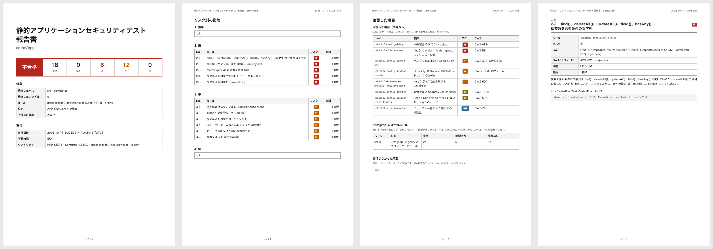

# Security SAST ドキュメント

CakePHP 2 アプリケーションの静的アプリケーションセキュリティテスト (SAST) です。文字列で組み立てた SQL、リクエストの値への
リダイレクト、エスケープしない変数の出力など、脆弱性につながる書き方をコードから探し、ルールとリスクごとの A4 の PDF の
報告書にします。報告書は [pieceofcake2/report](https://pieceofcake2.github.io/report/ja/) のデザインです。あるリスク以上の
指摘があれば、終了コードで CI を失敗にします。

- [ルール](rules.md): 各ルールが見つけるもの、なぜ危ないか、修正方法と、設定の検査
- [指摘を修正する](fixing.md): 最初のスキャンから、CI で問題のない状態を保つまでの進め方
- [GitHub Actions での CI](ci.md)

pieceofcake2 のセキュリティ診断の 1 つで、ほかに [pieceofcake2/security-sca](https://pieceofcake2.github.io/security-sca/ja/)
(Composer のパッケージの既知の脆弱性) と [pieceofcake2/security-dast](https://pieceofcake2.github.io/security-dast/ja/)
(動いているアプリケーション) があります。
pieceofcake2/security-check で、すべてを実行できます。

## 2 つのエンジン

このパッケージの CakePHP 2 向けのルールは、どちらのエンジンでも書いてあり、同じ箇所を見つけます。`--engine` で選びます。

| | Semgrep (デフォルト) | PHPStan |
| --- | --- | --- |
| 実行 | Docker (`semgrep/semgrep`) で | PHP で。このパッケージと一緒にインストールされます |
| ルール | このパッケージの CakePHP 2 のルールと、Semgrep Registry の PHP のルール (`p/php`) など | このパッケージの CakePHP 2 のルールだけ |
| ビュー (`.ctp`、`.php` など) | 検査します | 検査します |
| 必要なもの | Docker と、Registry のルールを取得するためのネットワーク | ほかにはありません |
| 箇所の除外 | `// nosemgrep: <ルール>` | `// @phpstan-ignore <識別子>` |

Semgrep は Registry のルールの分だけ多くを見つけます。PHPStan は、Docker を使えない環境など、PHP が動くところならどこでも
動きます。Registry のルールは Semgrep とコミュニティがメンテナンスしているもので、このパッケージは内容を確認していません。

## 必要なもの

- PHP 8.0 以上
- Semgrep: Docker。最初の実行で `semgrep/semgrep` のイメージを取得します
- PHPStan: ほかには不要です (`phpstan/phpstan` はこのパッケージの依存です)
- PDF を印刷するための Google Chrome または Chromium 131 以上。日本語の報告書には、Linux では `fonts-noto-cjk`

## インストール

```bash
composer require --dev pieceofcake2/security-sast
```

## 使い方

```bash
# Docker の Semgrep で
vendor/bin/security-sast --pdf=tmp/security-sast.pdf --language=ja

# PHPStan で
vendor/bin/security-sast --engine=phpstan --pdf=tmp/security-sast.pdf
```

コマンドは、結果の要約と報告書のパスを表示します。

```text
12 findings (5 high, 7 medium) of 8 rules in 3 files (Semgrep 1.180.0). Report: tmp/security-sast.pdf
```

終了コードは、`--fail-on` に達する指摘がなければ `0`、あれば `1`、検査や報告書の作成に失敗したときは `2` です。リスクが
不明な指摘は、`--fail-on=low` のときだけ不合格になります。

### 検査する範囲

パスは、二重に書かなくて済むよう、アプリケーションから取ります。プロジェクトに `config/core.php` (従来の構成では
`app/Config/core.php`) と `vendor/autoload.php` があれば、アプリケーションと同じように CakePHP を読み込み、次を取得します。

- アプリケーションのディレクトリ (`APP`)、ビューのパス (`App::path('View')`)、プラグインのパス (`App::path('Plugin')`)。
  これらを検査します
- Composer が `vendor` の外にインストールしたパッケージ (`plugins/DebugKit` など)。`vendor` と同じく除きます
- `AppController` のビューの拡張子 (`$ext`)。`.ctp` 以外なら、その拡張子もビューとして検査します

それ以外のときは、`src`、`templates`、`plugins` (新しい構成) と `app` (従来の構成) のうち、存在するディレクトリを
検査します。`vendor`、`tmp`、`logs`、`tests`、`node_modules`、`app/Vendor`、`app/tmp`、`app/Test` は除きます。

```bash
# src/ とビューだけ
vendor/bin/security-sast --paths=src,templates --exclude=vendor,tmp
```

PHP のファイル (`.php`) とビューを検査します。ビューとは、`templates/` か `View/` のディレクトリにある、ビューの
拡張子のファイルです。デフォルトの `ctp,php` では、`templates/Posts/index.php` は
ビューで、`src/Controller/PostsController.php` はビューではありません。ビューの拡張子は `--view-extensions` で足せます。

```bash
vendor/bin/security-sast --view-extensions=ctp,php,html
```

### 設定

同じく読み込んだ CakePHP で、アプリケーションの本番の設定も検査します。`APP_ENV=prod` (`--config-env`) の `.env`
ファイルを読んで、`config/bootstrap.php` を実行したあとの `Configure` の値です。デバッグレベルが 0 でない、
`Security.salt` が配布時の値やドキュメントのサンプルのまま、`cipher` の Cookie などを見つけます
([設定](rules.md#設定))。指摘は `core.php` のその設定の行に付き、報告書の表紙には検査した `APP_ENV` が載ります。秘密の値は
SHA-256 と長さで比べ、報告書には書きません。

設定を読み込めないときは、報告書にそう載り、`--fail-on` に関係なく終了コード `2` で終わります。設定を検査していない
からです。CakePHP のアプリケーションでないプロジェクトなどでは、`--config-check=0` で検査しないようにできます。

### オプション

| オプション | 環境変数 | デフォルト | |
| --- | --- | --- | --- |
| `--engine=ENGINE` | `SECURITY_SAST_ENGINE` | `semgrep` | `semgrep` か `phpstan` |
| `--pdf=PATH` | `SECURITY_SAST_PDF` | `tmp/security-sast.pdf` | PDF の報告書 |
| `--fail-on=RISK` | `SECURITY_SAST_FAIL_ON` | `high` | 不合格にする最も低いリスク。`critical`、`high`、`medium`、`low`、`none` |
| `--project=DIR` | | カレントディレクトリ | アプリケーションのディレクトリ |
| `--paths=LIST` | `SECURITY_SAST_PATHS` | 存在する `src`、`templates`、`plugins`、`app` | 検査するパス。カンマ区切りで、プロジェクトからの相対パス。`src` は `plugins/Blog/src` を含みません |
| `--exclude=LIST` | `SECURITY_SAST_EXCLUDE` | 上記のとおり | 除くパス。カンマ区切り。空にすると何も除きません |
| `--semgrep-config=LIST` | `SECURITY_SAST_SEMGREP_CONFIG` | `p/php` | このパッケージのルールのほかに使う Semgrep のルール。Registry の名前 (`p/owasp-top-ten`)、URL、プロジェクトの YAML ファイル |
| `--semgrep-image=IMAGE` | `SECURITY_SAST_SEMGREP_IMAGE` | `semgrep/semgrep:latest` | Semgrep の Docker イメージ。バージョンを固定するときなどに |
| `--docker=COMMAND` | `SECURITY_SAST_DOCKER` | `docker` | Docker のコマンド。`podman` など |
| `--phpstan=PATH` | `SECURITY_SAST_PHPSTAN` | このパッケージのもの | `phpstan` のスクリプト |
| `--view-extensions=LIST` | `SECURITY_SAST_VIEW_EXTENSIONS` | `ctp`、`php` と `AppController` の `$ext` | ビューの拡張子。カンマ区切り |
| `--safe-view-variables=LIST` | `SECURITY_SAST_SAFE_VIEW_VARIABLES` | | ビューで `h()` を通さずに出力してよい変数。カンマ区切り ([ルール](rules.md#cakephp2-view-unescaped-output)) |
| `--config-check=0` | `SECURITY_SAST_CONFIG_CHECK` | `1` | `0` で設定を検査しません |
| `--config-env=ENV` | `SECURITY_SAST_CONFIG_ENV` | `prod` | 検査する設定の `APP_ENV` |
| `--language=LANG` | `SECURITY_REPORT_LANGUAGE` | `en` | `en` か `ja`、または `--locale-dir` の言語 |
| `--locale-dir=DIR` | `SECURITY_REPORT_LOCALE_DIR` | | メッセージを足したり置き換えたりする `<言語>.json` のディレクトリ |
| `--title=TITLE` | `SECURITY_SAST_TITLE` | 言語のタイトル | 報告書のタイトル |
| `--project-name=NAME` | `SECURITY_REPORT_PROJECT` | `composer.json` の名前 | タイトルの下のプロジェクト名 |
| `--note=TEXT` | `SECURITY_SAST_NOTE` | | 表紙の注記 |
| `--settings=FILE` | `SECURITY_SETTINGS` | `config/security.php` か `app/Config/security.php` | 設定ファイル |

### 設定ファイル

pieceofcake2 のセキュリティ診断の設定は、プロジェクトの `config/security.php` (従来の構成では `app/Config/security.php`)
にまとめられます。診断ごとのセクション `sca`、`sast`、`dast` と、共通の `report` セクションを持つ配列を返します。

```php
<?php
return [
    'report' => [
        'language' => 'ja',
        'dir' => 'tmp/security',
        'project' => 'Acme',
    ],
    'sast' => [
        'engine' => 'phpstan',
        'failOn' => 'medium',
        'viewExtensions' => ['ctp', 'php', 'html'],
        'safeViewVariables' => ['body_html'],
    ],
];
```

セクションのキーは、オプションをキャメルケースにしたものです (`--fail-on` は `failOn`)。リストは配列で書きます。`report`
セクションには `language`、`localeDir`、`project` (プロジェクト名)、`note` と、報告書のディレクトリ `dir` があります (この例では
`tmp/security/security-sast.pdf` に書き出します)。`sast` セクションに知らないキーがあるとエラーになります。

オプションが環境変数より、環境変数が設定ファイルより優先されます。別のファイルは `--settings` で指定します。

## 報告書

- [見本の報告書 (日本語、PDF)](https://pieceofcake2.github.io/security-sast/report-sample-ja.pdf)
- [見本の報告書 (英語、PDF)](https://pieceofcake2.github.io/security-sast/report-sample.pdf)



1. **表紙**: 結果、リスクごとの指摘の数、リポジトリ、ブランチ、コミット、検査したパスとファイルの数、ルール、設定の
   `APP_ENV`、不合格の基準、実行の日時、環境、ソフトウェア (エンジンとそのバージョン)
2. **リスク別の指摘**: 緊急、高、中、低、不明の順に、箇所を見つけたルールとその箇所の数。それぞれのページへのリンク付き
3. **ルールごとのページ**: タイトル、ID、リスク、CWE、OWASP Top 10 の分類、確度、見つけたものと修正方法、続けて各箇所
   (ファイルと行) とそのコード。100 箇所まで

Semgrep のリスクは、`ERROR` が高、`WARNING` が中、`INFO` が低です。このパッケージのルールは、それぞれのリスクを
決めています ([ルール](rules.md))。

## 指摘を除外する

まず箇所を確かめてください。ほとんどの指摘は本物です。クエリの変数が定数であるなど、その箇所が安全なときは、理由を
コメントに書いて、その箇所の指摘を除外します。

Semgrep:

```php
// テーブル名はモデルの定数
// nosemgrep: cakephp2-query-concatenation
$this->query('TRUNCATE ' . self::TABLE);
```

PHPStan では、ルールの識別子 ([ルール](rules.md)) を指定します。

```php
// テーブル名はモデルの定数
$this->query('TRUNCATE ' . self::TABLE); // @phpstan-ignore securitySast.queryConcatenation
```

パスごと除くときは `--exclude` を使います。設定の指摘は設定で修正するか、`--config-check=0` で検査しないようにします。

## 自分のルール

Semgrep は、`--semgrep-config` に指定したプロジェクトの YAML ファイルも、このパッケージのルールと一緒に実行します。

```bash
vendor/bin/security-sast --semgrep-config=p/php,config/semgrep/app.yml
```

書き方は [Semgrep のルールの構文](https://semgrep.dev/docs/writing-rules/rule-syntax) をご覧ください。このパッケージの
ルール [resources/semgrep/cakephp2.yml](../../resources/semgrep/cakephp2.yml) が例になります。

## トラブルシューティング

**`Semgrep failed (exit code 125): Cannot connect to the Docker daemon`**: Docker が動いていないか、そのユーザーが使えません。
Docker を起動するか、`--engine=phpstan` を使ってください。

**`Semgrep failed (exit code 7): ... invalid configuration`**: ルールを読み込めませんでした。`--semgrep-config` の YAML
ファイルの誤りや、存在しない Registry の名前などです。メッセージにどれかが出ます。一部のルールなしの検査は、それを
確かめずに合格してしまうので、検査を止めます。

**`Semgrep failed ... Failed to download configuration`**: Registry のルール (`p/php`) を取得できませんでした。
`semgrep.dev` へのネットワークを許可するか、`--semgrep-config=` (空) でこのパッケージのルールだけを実行してください。

**`The configuration could not be loaded`**: `APP_ENV=prod` で読み込んだとき、`config/bootstrap.php` か `core.php`
が失敗しました。`.env` ファイルやデータベースが必要な場合などです。メッセージにエラーが出ます。`--config-env` で CI の
環境を指定するか、`--config-check=0` で検査しないようにしてください。

**`Nothing to scan in .`**: プロジェクトに `src`、`templates`、`plugins`、`app` のどれもありません。`--paths` でパスを
指定してください。

**報告書に「エンジンがエラーを報告しました」と出る**: PHP の構文エラーなどで、読めないファイルがありました。ほかの
ファイルは検査しています。

**`Chrome is needed to print the report`**: Chrome か Chromium をインストールするか、`REPORT_CHROME_BINARY` を設定して
ください ([pieceofcake2/report](https://pieceofcake2.github.io/report/ja/))。
